  
  
  

 

### `> whoami`

I'm **Cezary**, 19, and I've been programming since I was twelve. I'm in my fifth year at an IT technical high school in Poland and a student at **42 Heilbronn**.

I founded **[CesaSec](https://cesasec.com)** to build software that keeps your data private, protected by modern and post-quantum cryptography.

 

 

### `> toolkit`

  
  
  
  
  
  
  

  
  
  
  
  
  
  
  

 

### `> now building`

Pairing runs on **CPQHA**, my custom hybrid post-quantum protocol. CesaConn uses FIPS-approved algorithms; an independent audit of CPQHA is planned. **[cesasec.com/cesaconn ↗](https://cesasec.com/cesaconn)**

 

### `> also`

I build fast, animated websites that look premium and work on every phone, tablet and desktop. See them on **[czarekk.dev ↗](https://czarekk.dev)**.

 

<code>sys.krnl</code> · Let's build something <i>secure</i>. · <a href="mailto:sys.krnl@proton.me">sys.krnl@proton.me</a>

